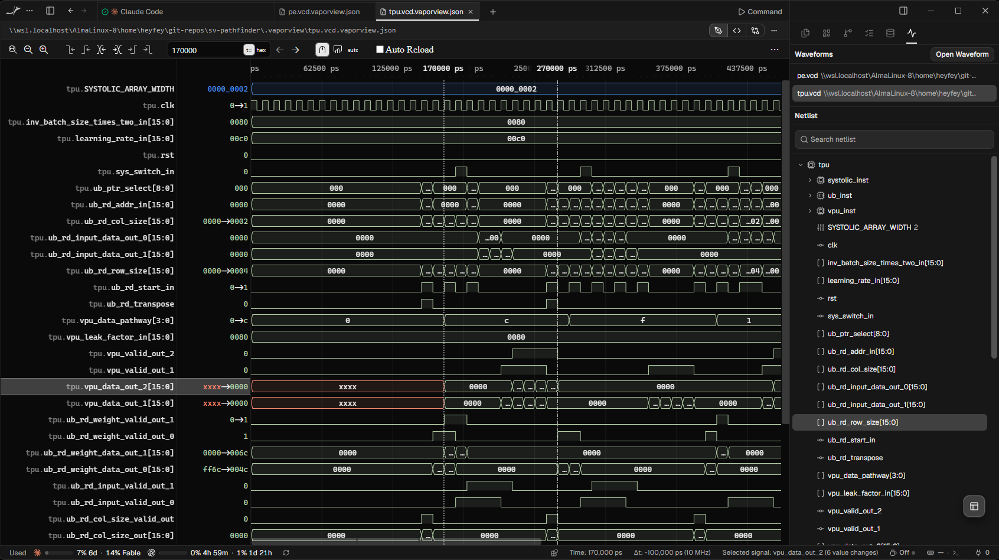

# vaporview-orca

A waveform viewer for the [Orca](https://github.com/stablyai/orca) ADE. It is the VS Code extension
[vaporview](https://github.com/Lramseyer/vaporview) as an Orca plugin. It opens VCD, FST, and GHW
files, and it looks and works like vaporview.

This project is a prototype. It is not a part of vaporview or of Orca. All credit for the viewer
goes to the vaporview authors.

## Install

The plugin is not yet in the Orca plugin catalog. For now, build it from the source:
[docs/development.md](docs/development.md).

## Use

Open the Vaporview panel in the right sidebar and select "Open Waveform". After that, the viewer
works like vaporview.

Differences from vaporview:

- You open and close a waveform in the panel, not in the file explorer. The panel lists the open
  waveforms of the workspace.
- The plugin keeps the view of each waveform (signals, zoom, markers) in the folder `.vaporview/`
  of the workspace.
- Some vaporview features are not available. [docs/feature-parity.md](docs/feature-parity.md) has
  the state of each feature.

## Development

- [docs/development.md](docs/development.md): build, test, and repository layout
- [docs/architecture.md](docs/architecture.md): design and decisions

## License

GPL-3.0, the same as vaporview. See [LICENSE](LICENSE).
